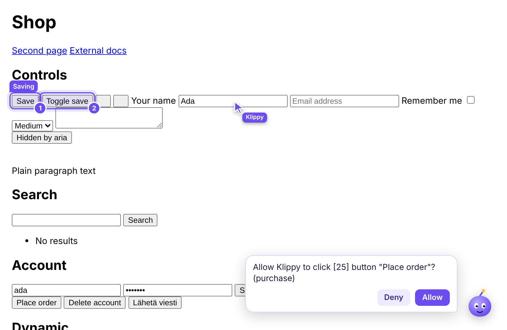

# Klippy

A Clippy-style AI assistant that lives on every page in your real Chrome.



- **Watch it work** — its own ghost cursor walks to what it's about to click;
  your real mouse stays yours.
- **It shows you things** — highlights, speech bubble, (soon) pinned notes and a trail.
- **It knows what changed** — a deterministic page diff after every action,
  so even a small model knows whether its click did anything.
- **Safe by design** — risky actions (buy, send, delete, passwords, POST forms) need your
  confirmation on the page; the agent cannot click "Allow" for you.
- **Bring your own brain** — the browser side is a thin body that speaks MCP; any agent
  (Claude Code, Codex, a local Ollama loop) can drive it.
- **Coming next** — voice (push-to-talk, Finnish + English), local models, classifier
  layer, VPS headless mode, background workers.

Status: **M0** — Chrome extension + MCP bridge working, 33 tests.
Design: [docs/IDEA.md](docs/IDEA.md) · Architecture: [docs/ARCHITECTURE.md](docs/ARCHITECTURE.md)

## Quick start

```sh
npm install
npm run build
```

1. Chrome → `chrome://extensions` → Developer mode → **Load unpacked** → `dist/extension`.
2. Get the bridge token: `node dist/bridge/klippy-mcp.js --print-token`
   (creates `~/.config/klippy/token` on first run).
3. Open the Klippy extension **options**, paste the token, keep port `17345`, save.
4. Add the bridge to your agent, e.g. Claude Code:

   ```sh
   claude mcp add klippy -- node "$PWD/dist/bridge/klippy-mcp.js"
   ```

   Any MCP client works the same way (stdio command `node dist/bridge/klippy-mcp.js`).
5. Ask the agent something like *"Use Klippy: take a snapshot of this page and highlight
   the search box."*

The extension reconnects to the bridge automatically (within ~30 s) whenever the agent
starts it. The options page shows the connection status.

## Tools

| Tool | Does |
|---|---|
| `snapshot` | compact indexed page map: `[12] button "Save" disabled` |
| `read_html` | cleaned HTML of one element subtree |
| `click`, `type`, `press` | act with trusted input; return what changed |
| `point`, `highlight`, `clear_highlights`, `say` | show things to the user |
| `scroll`, `navigate`, `tabs`, `status` | the rest |

## Development

```sh
npm run build       # dist/extension, dist/bridge/klippy-mcp.js, dist/eyes.iife.js
npm run typecheck
npm test            # eyes + gate unit tests and a full Chromium + extension + bridge e2e run
```

The e2e suite loads the extension into Playwright's Chromium (new headless), starts the
bridge, and drives everything over MCP exactly like an agent would — including answering
the on-page confirmation prompts with real clicks.

## License

Not chosen yet.
